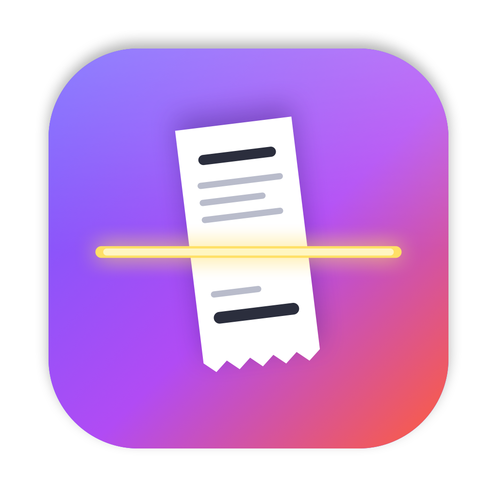
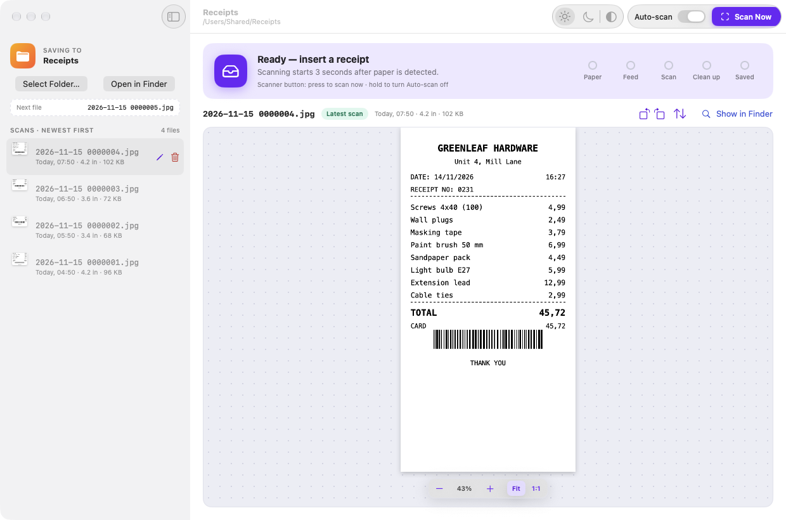
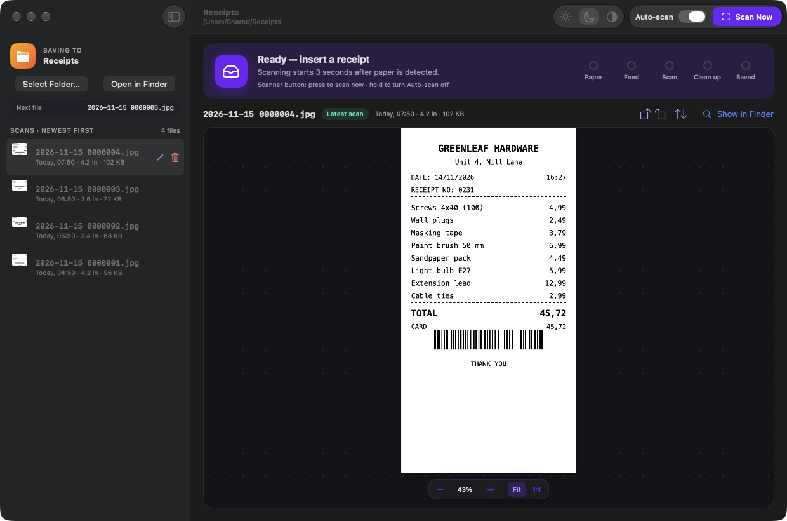

<p align="center">
  
</p>

<h1 align="center">Scanline</h1>

<p align="center">
  A native macOS app for the <b>IRIScan Express 4</b> receipt and document scanner.<br>
  Apple Silicon, no Rosetta, no kernel extension, no vendor software.
</p>



## Why

The IRIScan Express 4 (an Avision-made sheet-fed scanner) only worked on macOS through the
vendor's *Capture Tool*: an Intel-only app, a TWAIN driver and a third-party kernel extension
that needs Reduced Security on Apple Silicon. Rosetta and third-party kernel extensions are on
their way out, and the vendor no longer updates the software.

Scanline talks to the scanner directly over USB. The protocol was worked out from the vendor
driver and a recorded scan; see [docs/protocol.md](docs/protocol.md).

## Features

- **Auto-scan:** insert a receipt and it scans after a short countdown (1–5 s, or off).
- **Scanner button:** press to scan now, hold to switch Auto-scan on or off.
- **Clean output:** cropped to the receipt, straightened, rescaled to true size, black and white,
  saved as 300 dpi JPEG.
- **Turns receipts upright:** receipts fed upside down or sideways are detected (on-device text
  check) and rotated.
- **Catches bad feeds:** sheets the rollers didn't take and scans that stopped half-way are reported
  and not saved.
- **Live folder:** newest-first list with thumbnails; rename, rotate, move to Trash with Undo.
- **Viewer:** fit, 1:1, pinch or ⌘± to zoom, drag to pan.
- **Files named** `YYYY-MM-DD NNNNNNN.jpg`, continuing from the highest number in the folder.
- Light, Dark or match the system.



## Requirements

- A Mac with Apple Silicon, macOS 26 or later.
- IRIScan Express 4 (USB `0A38:0161`). Its siblings (IRIScan Executive 4 `0162`, IRIScan Pro 5 `0163`)
  use the same vendor driver but are untested.

## Installing

1. Download `Scanline-<version>.zip` from [Releases](../../releases) and unzip it.
   To check the download: `shasum -a 256 -c Scanline-<version>.zip.sha256`
2. Scanline isn't notarized yet, so macOS blocks it the first time. Either run
   `xattr -dr com.apple.quarantine Scanline.app`, or open it once, then allow it in
   **System Settings › Privacy & Security › Open Anyway**.
3. Move **Scanline.app** to Applications and open it.
4. Click **Install Helper…** (sidebar, or **Settings › Scanner**) and enter your password once.

### About the helper

Reading the scanner means taking its USB interface from macOS's mass-storage driver, which needs
root and has to happen inside your login session. Scanline therefore installs:

- `/Library/PrivilegedHelperTools/local.scanline.helper`, a small program that only moves scanner
  commands between the app and the device, and
- `/etc/sudoers.d/scanline-helper`, a rule that lets **your** user run exactly that program with
  its single `--stdio` argument as root, without a password. The rule is pinned to the helper's
  SHA-256, so sudo refuses to run the file if it is ever replaced; reinstalling the helper from
  Scanline writes a new rule for the new file.

The installer stages the new helper, hashes the copy as root (it must match what the app checked),
validates the rule with `visudo`, and only then swaps in the helper and the rule, so a failed or
cancelled install leaves the previous one working.

The app starts the helper as its child and talks to it over a pipe. When Scanline quits (or
crashes) the helper releases the scanner and exits, and macOS gets the device back.

## Using it

1. **Select Folder…** to choose where scans go.
2. Insert a receipt. With Auto-scan on it scans after the countdown; pull the sheet back out to cancel.
   With Auto-scan off, press the scanner's button or **Scan Now** (⌘↩).
3. The scan appears in the viewer and at the top of the list. Select a scan to rename, rotate or trash it.

The scan log is at `~/Library/Logs/Scanline/scan.log` (**Settings › Open Scan Log**).

## Moving off the vendor software

Once Scanline works for you, Capture Tool, the TWAIN driver and the kernel extension can go, and
the Mac can return to Full Security:

1. Back up and remove `/Applications/Capture Tool.app`,
   `/Library/Image Capture/TWAIN Data Sources/IRIS.ds` and `/Library/Extensions/AvKernel.kext`
   (the installer receipts are `com.iris.app.pkg`, `com.iris.twain.pkg`, `com.iris.kextarm.pkg`).
2. In Recovery: **Utilities › Startup Security Utility › Security Policy › Full Security**.
   Apple Silicon keeps approved kernel extensions in a cached collection, so the old driver keeps
   loading until this step (or `kmutil trigger-panic-medic` in Recovery's Terminal).

Scanline needs neither, so this is safe to do once you're happy with it.

## Building from source

Xcode 26 (Swift 6) on an Apple Silicon Mac. No Apple Developer account is needed; builds are
ad-hoc signed.

```bash
swift build                    # debug build of everything
swift test                     # unit tests (no scanner needed)
scripts/build-app.sh           # build/Scanline.app
scripts/build_release.sh       # build/Release/: checked Scanline.app, Scanline.zip, dSYM
scripts/install-local.sh       # release build -> /Applications, Desktop alias, launch
```

Run against a simulated scanner (adds a **Simulator** menu; settings are not saved):

```bash
SCANLINE_SIMULATE=1 build/Scanline.app/Contents/MacOS/Scanline
```

`scanprobe` is a command-line tool for poking at the scanner:

```bash
swift build -c release --product scanprobe
sudo .build/release/scanprobe info --usb      # identity, model, paper sensor
sudo .build/release/scanprobe scan out.pgm --usb
.build/release/scanprobe process in.pgm out.jpg   # image pipeline only
```

### Layout

| Path | What |
|---|---|
| `Sources/Scanline` | The SwiftUI app |
| `Sources/ScanlineCore` | Scanner protocol, helper client, kext transport, image processing, scan session |
| `Sources/ScanlineUSB` | USB transport and the helper's wire protocol and request loop (all the helper links) |
| `Sources/CUSBHost` | Small Objective-C wrapper over IOUSBHost (device capture, bulk pipes) |
| `Sources/ScanlineHelper` | The privileged helper |
| `Sources/scanprobe` | Command-line probe |
| `Tests/ScanlineCoreTests` | Protocol bytes, simulator, session, image pipeline tests |
| `tools/icon` | Renders the app icon |
| `docs/` | Protocol notes and design decisions |

## Uninstalling

```bash
sudo rm -f /Library/PrivilegedHelperTools/local.scanline.helper /etc/sudoers.d/scanline-helper
rm -rf /Applications/Scanline.app ~/Library/Logs/Scanline
defaults delete local.scanline.app
```

## Status

Personal project, built for one scanner. Not affiliated with IRIS, Canon or Avision.

## License

Scanline is licensed under the [GNU Affero General Public License v3.0](LICENSE).
